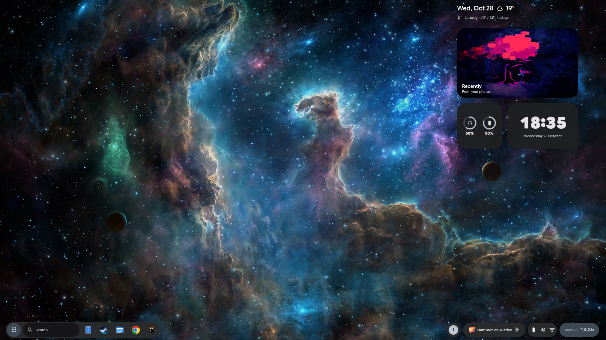
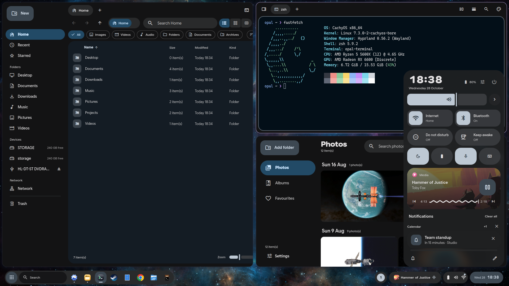
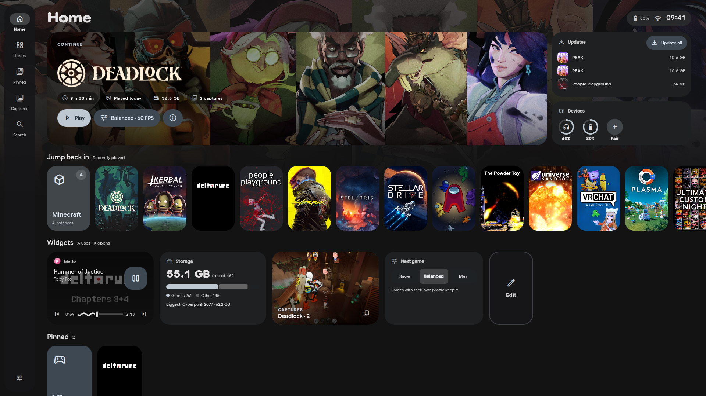
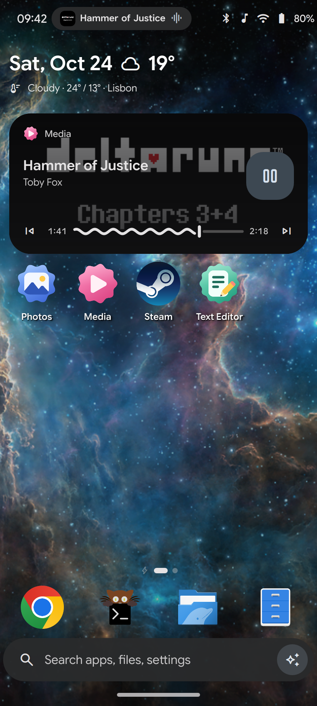
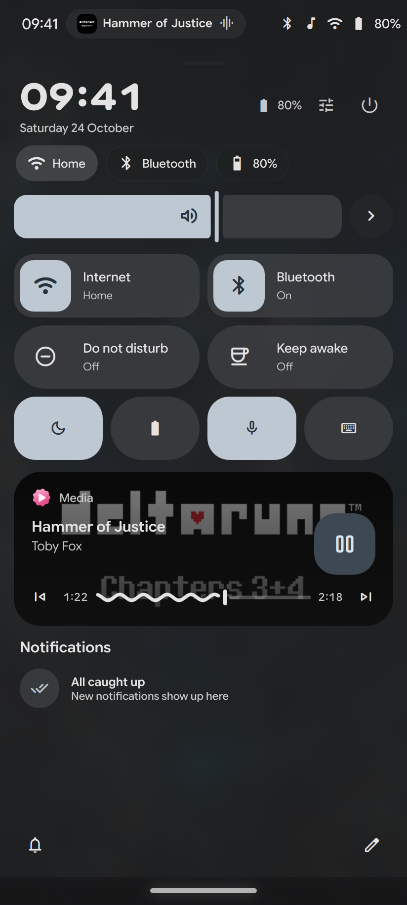
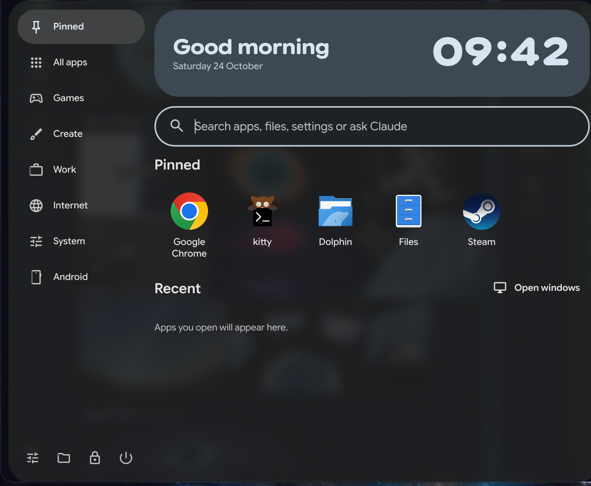

<div align="center">

# Opal

**An adaptive Material 3 Expressive shell for Linux desktops, phones, tablets, and handheld consoles.**

[](LICENSE)
[](https://quickshell.outfoxxed.me)
[](#layouts)

[Features](#features) · [Screenshots](#screenshots) · [Install](#install) · [Shortcuts](#keyboard-shortcuts) · [CLI](#cli-reference) · [Development](#development)

<br>



</div>

---

## Overview

Opal is the shell and design system of **lunaOS**. Built on Quickshell, Qt 6 Quick, Wayland `layer-shell`, and Python 3 adapters, it scales a single codebase and Material 3 Expressive token system across desktop monitors, touchscreens, and controller-first living-room or handheld displays.

## Screenshots

| Desktop & Quick Settings | Console Home |
| :---: | :---: |
|  |  |

| Phone Home | Phone Quick Settings | Start Menu |
| :---: | :---: | :---: |
|  |  |  |

---

## Features

### Desktop
- **Four bar layouts** — Choose between `islands`, `dock`, `split`, or `edge`. Includes a live activity pill for media and active timers, inline volume and workspace feedback, and a taskbar that reorders by drag-and-drop.
- **Start menu & launcher** — Category rail, A–Z filter, pinned and recent apps, live window search, inline math (`= (18 + 4) * 3`), shell commands (`> dark`, `> capture`), web search (`? query`), and optional Claude queries (`! prompt`) via the bundled Opal MCP server.
- **Quick Settings & notifications** — A single adaptive sheet with pill-to-squircle tiles, Wi-Fi and Bluetooth pairing pages, audio routing, display arrangement, and reorderable sections (calendar, system monitor, clipboard history, focus timer, batteries, and linked devices).
- **Desktop widgets & windowing** — Wallpaper-frosted desktop cards for clock, date, recent apps, quick actions, and media. On Hyprland, Opal adds snap layouts (`Super + Z`), an Alt+Tab window switcher with live Wayland screencopy thumbnails, and an optional floating window mode with themed titlebars.
- **Capture Studio** — Area, window, and full-screen screenshots with an inline markup editor and screen recording (`Super + Shift + S` / `Super + Shift + R`).

### Phone & Tablet
- **Touch navigation** — Dedicated status bar and either gesture navigation (swipe up for Home, hold for Recents, edge swipe for Back) or three-button navigation, plus auto-rotation via `iio-sensor-proxy`.
- **Home pages & drawer** — Editable home grid with widgets, folders, dock favorites, and a categorized A–Z app drawer.
- **Thumb-zone controls** — Quick Settings and the shared `PowerSheet` align interactive controls toward the bottom of tall screens for one-handed reach.
- **Borealis system keyboard** — Standalone Wayland `input-method-v2` on-screen keyboard (`opal-keyboard`) with local word suggestions, emoji picker, clipboard cards, a terminal symbol/modifier deck, one-handed and split layouts on wide screens, and gamepad navigation.

### Console & Handheld
- **Unified game library** — Aggregates installed games and artwork from Steam, Steam shortcuts, Prism Launcher, Heroic, Lutris, and RetroArch into a controller-driven cover grid and Play Hub.
- **Quick Access overlay** — Opens over fullscreen games (`Guide` or `Super + Ctrl + Q`) with session playtime, game switching, MangoHud FPS limiter and overlay controls, `gamemoded` status, power profiles, and the TV-scaled power menu.
- **Full controller navigation** — D-pad, sticks, and face buttons drive every Opal overlay (Quick Settings, notifications, Settings, Polkit, lock screen, power sheet, and on-screen keyboard) with Xbox and Nintendo button legends.
- **Standalone Gamescope session** — Run `opal game-session` from a TTY or login manager to boot straight into a SteamOS-style Gamescope session, or run it in a desktop window for testing.

### Convergence & Continuity
- **Automatic display convergence** — Each display resolves its own layout (`desktop`, `phone`, or `console`). Attaching a monitor, keyboard, mouse, or flipping a tablet-mode switch transitions the display layout automatically with an undo toast and migrates open windows on Hyprland.
- **Opal Link** — Built-in KDE Connect protocol 8 service (`opal_link.py`) that pairs with phones and other Opal machines for battery status, media controls, clipboard sharing, and "Open here" session continuity.

### Theming & System Services
- **Material 3 Expressive & Omarchy themes** — Dynamic palettes extracted from your wallpaper, built-in palettes, or Omarchy `colors.toml` themes (`opal theme`). Typography uses Google Sans Flex variable axes and Material Symbols Rounded. Themes export live to GTK, Qt, Kitty, and window borders.
- **Lock screen, Greeter & Polkit** — Built-in PAM lock screen (`Super + L`), `greetd` login greeter (`opal greeter`), standalone Polkit authentication agent (`opal polkit`), and `xdg-desktop-portal` FileChooser dialog (`opal portal`).

---

## Install

### From a git checkout

```sh
cd opal
./install.sh --restart
```

`install.sh` installs missing runtime packages (`pacman`, `dnf`, or `apt`), copies the shell to `~/.config/quickshell/opal`, installs the `opal` CLI into `~/.local/bin`, builds the Borealis keyboard, and adds a reversible runtime hook to `~/.config/hypr/hyprland.lua`. Previous installs are backed up under `~/.local/state/opal/backups/`.

| Flag | Description |
| :--- | :--- |
| `--restart` | Reload the running Opal shell immediately after installing |
| `--no-deps` | Skip system package installation |
| `--no-keyboard` | Skip building and installing the Borealis keyboard |
| `--no-hyprland` | Do not modify `~/.config/hypr/hyprland.lua` |

### Switch from another desktop

To install Hyprland, Quickshell, and Opal alongside an existing GNOME, KDE Plasma, or Xfce setup and carry over your wallpaper, theme, pinned apps, and keyboard layout:

```sh
./tools/switch/opal-switch --gui
```

Run `opal switch --undo` at any time to remove the Opal login session and restore your previous settings.

---

## Keyboard Shortcuts

| Shortcut | Action |
| :--- | :--- |
| `Super` / `Super + Space` / `Alt + Space` | Open Start menu & launcher |
| `Super + ,` / `Super + X` | Open Quick Settings |
| `Super + N` | Open Notifications |
| `Alt + Tab` / `Super + Tab` | Window switcher |
| `Super + V` | Clipboard history |
| `Super + A` / `Copilot` | Assistant |
| `Super + Z` | Snap layouts |
| `Super + Shift + S` / `Print` | Capture Studio (screenshot & markup) |
| `Super + Shift + R` | Toggle screen recording |
| `Super + L` | Lock screen |
| `Super + Escape` | Power menu |
| `Super + Ctrl + D` / `P` / `G` | Switch layout to Desktop / Phone / Console |
| `Super + Ctrl + Q` / `Guide` | Console Quick Access overlay |

---

## CLI Reference

```sh
opal on | reload | off          # Start, reload, or stop the shell
opal autostart [on|off]         # Toggle starting Opal at login
opal desktop | phone | console  # Switch the active layout mode
opal launcher | controls | lock # Toggle individual shell surfaces
opal quickaccess                # Toggle the console Quick Access sheet
opal appearance                 # Open theme & wallpaper settings
opal theme [list|set|follow]    # Manage palettes and Omarchy themes
opal greeter [--revert]         # Install or remove the greetd login greeter
opal polkit                     # Install the standalone Polkit user service
opal portal [on|off|touch]      # Configure the xdg-desktop-portal FileChooser
opal game-session               # Launch Opal inside Gamescope
opal switch [--gui|--undo]      # Run or revert the desktop switch assistant
opal inspect                    # Print JSON state diagnostics
```

---

## Requirements

- **Core**: `quickshell`, `qt6-declarative`, `qt6-wayland`, `python3`, and a Wayland compositor implementing `wlr-layer-shell` (Hyprland recommended for window management, blur rules, and workspace migration).
- **System integrations** *(optional, graceful fallback when absent)*: `wpctl` (WirePlumber), `playerctl`, `nmcli` (NetworkManager), `bluetoothctl`, `brightnessctl`, `powerprofilesctl`, `gamemoded`, `mangohud`, `grim`, `wl-clipboard`, `iio-sensor-proxy`.

---

## Development

<details>
<summary><strong>Repository layout & test suites</strong></summary>

<br>

```text
opal/
├── src/                 # QML components, singletons, Python adapters, and Hyprland Lua hook
├── keyboard/            # Borealis Wayland on-screen keyboard (C++ / Qt Quick)
├── compositor/          # luna-compositor (Waylib / Qt Wayland compositor work)
├── services/            # System daemons and D-Bus helpers
├── tools/               # Installer, feel-lint, frame-lab, and desktop switch assistant
├── promo/               # Sandboxed screenshot session and Remotion promo video
└── tests/               # Python unit suites and offscreen QML render harness
```

Run the test and lint suites from `opal/`:

```sh
# Unit tests and static feel-lint checks
python3 -m unittest discover -s tests -p 'test_*.py'
python3 tools/feel-lint.py --check

# Isolated offscreen QML renders (never touches the live desktop)
bash tests/render-offscreen.sh
OPAL_ONLY=power- bash tests/render-offscreen.sh
```

</details>
